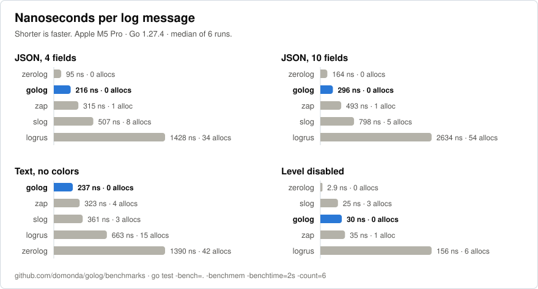
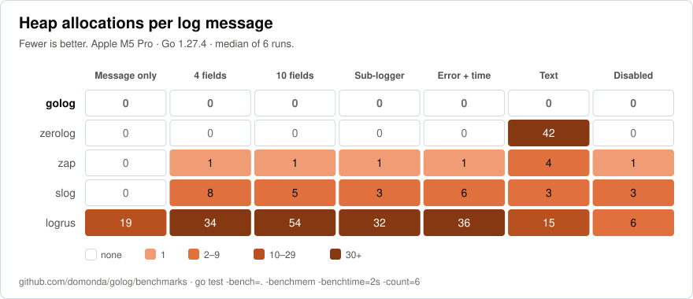

# golog

Zero-allocation structured logging for Go. The same logger writes colored text in a terminal and JSON everywhere else.

[](https://github.com/domonda/golog/actions/workflows/go.yml)
[](https://github.com/domonda/golog/actions/workflows/gosec.yml)
[](https://github.com/domonda/golog/releases)

[](https://pkg.go.dev/github.com/domonda/golog)
[](LICENSE)

In production at [domonda](https://www.domonda.com) since 2023.

## Install

```bash
go get github.com/domonda/golog
```

Requires Go 1.27 or later, the first Go release with generic methods, which v1.5 uses. The v1.4 release line keeps Go 1.26 compatibility:

```bash
go get github.com/domonda/golog@v1.4
```

The same goes for the `goslog` and `logsentry` modules below: append `@v1.4`.

## Quick Start

```go
package main

import (
    "errors"

    "github.com/domonda/golog/log"
)

func main() {
    log.Info("Server started").Int("port", 8080).Log()
    log.Error("Payment failed").Str("order", "A-1001").Err(errors.New("card declined")).Log()
}
```

In a terminal the output is colored text:

```text
2026-10-31 13:24:01.270 |INFO | Server started port=8080
2026-10-31 13:24:01.270 |ERROR| Payment failed order="A-1001" error=`card declined`
```

Piped to a file or a log collector, the same program writes JSON:

```json
{"time":"2026-10-31 13:24:01.270","level":"INFO","message":"Server started","port":8080}
{"time":"2026-10-31 13:24:01.270","level":"ERROR","message":"Payment failed","order":"A-1001","error":"card declined"}
```

Set the `LOG_LEVEL` environment variable to `TRACE`, `DEBUG`, `INFO`, `WARN`, `ERROR` or `FATAL` to choose the lowest level that gets logged. The default is `DEBUG`.

## Features

- **Logs without allocating** — 0 allocations per message for JSON and uncolored text output, including errors and `time.Time` fields. See [Performance](#performance).
- **No type casts for your own types** — `Str`, `Int`, `UUIDs` and the other typed methods are generic (v1.5, Go 1.27): pass a `type OrderID string` without `string(…)`, or a `[]uuid.UUID` without copying it into a `[][16]byte` first. Still 0 allocations. See [Named Types](#named-types).
- **Picks the output format** — the `log` package writes colored text to a terminal and JSON when output is piped, with no setup.
- **Writes to several places at once** — for example colored text on stdout plus warnings and errors as JSON in a size-rotated file, each writer with its own format and level filter.
- **Reports errors to Sentry** — the `logsentry` module turns errors logged with `Err` into Sentry exceptions, keeping the stack trace the error carries.
- **Carries request context** — attributes stored in a `context.Context` appear on every message logged with it. The HTTP middleware puts a request ID there, taken from `X-Request-ID` or generated.
- **Protects inherited keys** — a message can't duplicate or override a key its logger, sub-logger or context already set, such as `service` or `requestID`.
- **Logs structs by their tags** — reuses your `json` tags (or `golog` and `log` tags) with `omitempty`-style modifiers, and prints `***REDACTED***` for fields tagged `redact`.
- **Backs `log/slog`** — the `goslog` module turns a golog logger into a `slog.Handler` that passes the standard library's `slogtest` suite.
- **Ignores a nil logger** — `Info`, `Error` and the other level methods on a nil `*Logger` return a message that logs nothing, instead of panicking.
- **Never panics or hangs on a logged value** — a panic in a method golog calls on a value, like `Error`, `String`, `Log` or `MarshalJSON`, is logged as error string, and a value that references itself, like a `[]any` that contains itself or Loggables that log each other, is logged with a cycle error instead of recursing forever, and a value that would take exponential time to write is logged as error.

`goslog` and `logsentry` are separate modules, so the core module doesn't pull in the Sentry SDK:

```bash
go get github.com/domonda/golog/goslog
go get github.com/domonda/golog/logsentry
```

## Performance

**No heap allocation per message, in JSON and in text. Faster than zap and slog in 6 of 7 benchmarks; zerolog is faster at JSON.**

<picture>
  <source media="(prefers-color-scheme: dark)" srcset="benchmarks/charts/speed-dark.svg">
  
</picture>

<picture>
  <source media="(prefers-color-scheme: dark)" srcset="benchmarks/charts/allocs-dark.svg">
  
</picture>

Messages, attributes and writers come from object pools, so a message allocates nothing, with errors, `time.Time` fields and the attributes of a sub-logger included. Only colored terminal output allocates, a few strings for the color codes.

- **zap and slog**: golog is faster in 6 of 7 scenarios against each. zap is faster with a sub-logger (250 vs 255 ns), slog when the level is disabled (25 vs 30 ns, with 3 allocations).
- **zerolog**: about 2.3× faster at JSON (95 vs 216 ns with 4 fields), and about 6× slower at text (1390 vs 237 ns, with 42 allocations).

The charts measure one writer, as the other libraries are configured. golog does more per message without allocating, measured with the same 4 fields:

| golog, 4 fields                                            | per message      |
|------------------------------------------------------------|------------------|
| One JSON writer                                            | 209 ns, 0 allocs |
| JSON and uncolored text writer in the same call            | 430 ns, 0 allocs |
| Plus 2 attributes from the `context.Context`               | 260 ns, 0 allocs |
| Sub-logger attribute, 2 context attributes and both writers | 631 ns, 0 allocs |

The comparative benchmarks live in their own module, so zerolog, zap and logrus never become dependencies of golog. Run them from a clone of this repository:

```bash
go test ./benchmarks -bench=. -benchmem -benchtime=2s   # golog vs zerolog, zap, slog, logrus
go test ./goslog -bench=. -benchmem                     # golog as slog.Handler
```

All scenarios, the raw results and how to redraw the charts: [benchmarks/README.md](benchmarks/README.md).

## Configuring a Logger

The `log` package covers the common case. Build your own logger with `golog.NewConfig` when you need other writers, formats or levels.

### Text Output

```go
package main

import (
    "errors"
    "os"

    "github.com/domonda/golog"
)

func main() {
    config := golog.NewConfig(
        &golog.DefaultLevels,
        golog.AllLevelsActive,
        golog.NewTextWriterConfig(os.Stdout, nil, nil),
    )

    log := golog.NewLogger(config)

    log.Info("Hello, World!").Log()
    log.Error("Something went wrong").Err(errors.New("example error")).Log()
}
```

### JSON Output

```go
config := golog.NewConfig(
    &golog.DefaultLevels,
    golog.AllLevelsActive,
    golog.NewJSONWriterConfig(os.Stdout, nil),
)

log := golog.NewLogger(config)

start := time.Now()
// ... perform login ...
log.Info("User login").
    Str("username", "john_doe").
    Str("ip", "192.168.1.1").
    Duration("login_time", time.Since(start)).
    Log()
```

Output (matches `NewDefaultFormat`: `"time"` key, `"2006-01-02 15:04:05.000"` layout):
```json
{"time":"2024-01-15 10:30:45.000","level":"INFO","message":"User login","username":"john_doe","ip":"192.168.1.1","login_time":"150ms"}
```

### Typed Fields

```go
requestID := golog.UUIDv4()           // [16]byte UUID
jsonBytes := []byte(`{"key":"value"}`) // Raw JSON

log.Info("Processing request").
    Str("method", "POST").
    Str("path", "/api/users").
    Int("user_id", 12345).
    Bool("authenticated", true).
    Float("response_time", 0.145).
    UUID("request_id", requestID).
    Time("started_at", time.Now()).
    Strs("tags", []string{"api", "user", "create"}).
    JSON("metadata", jsonBytes).
    Log()
```

Bytes have one meaning everywhere: a string if they are valid UTF-8, else encoded with `golog.BinaryEncoder`, as `StrBytes` logs them. That includes bytes passed to `Any` or logged as struct fields. A byte slice type with a format of its own, like `net.IP` or `net.HardwareAddr`, is logged as one value with that format instead of as bytes: as error or `Loggable`, else with its `MarshalJSON`, `MarshalText` or `String` method. Three methods exist for other purposes: `Bytes` always logs binary data encoded with `golog.BinaryEncoder`, `JSON` logs JSON, and `Uint8s` logs a `[]uint8` (the same Go type as `[]byte`) as numbers. `golog.BinaryEncoder` defaults to unpadded URL-safe base64; set it at program start for another encoding, for example `golog.BinaryEncoder = hex.EncodeToString`. Only a struct or map passed as a whole to `Any` is encoded by `encoding/json`, which writes its bytes as standard base64 with padding; `StructFields` logs struct fields with golog's rules.

`Any` logs other values like the matching typed method: a `time.Time` like `Time`, formatted with the writer's `TimeFormat` and `Location` and `null` for the zero time, and a `json.RawMessage` like `JSON`. The elements of a `[]any` keep their own types, so `Any("vals", []any{1, "two", true, nil})` logs `[1,"two",true,null]`. A value that implements `error` is logged as its error string, also as an element of a slice, so `Any("errs", []error{errors.New("a"), nil})` logs `["a",null]`. Like `encoding/json`, a value with a `MarshalJSON` or `MarshalText` method is logged with it, also with pointer receiver for a struct passed as pointer, so a type can redact a secret. A `[16]byte` is logged as UUID, and so is a named `[16]byte` type that holds a UUID, like `uuid.UUID` of `github.com/google/uuid`, unless it has such a method that formats it differently.

### Types That Log Themselves

A type implements `golog.Loggable` with a `Log(*golog.Message)` method that logs its fields. Use it to decide which fields of a type belong in the log, for example to leave out personal data:

```go
type User struct {
    ID    int
    Name  string
    Email string
}

// Log implements golog.Loggable without the email address
func (u User) Log(m *golog.Message) {
    m.Int("id", u.ID).Str("name", u.Name)
}
```

`Loggable` logs the fields as fields of the message. `Any` logs them as a JSON object under a key, also for the elements of a slice:

```go
log.Info("Signed in").Loggable(user).Log()
// {"time":"…","level":"INFO","message":"Signed in","id":7,"name":"Alice"}

log.Info("Signed in").Any("user", user).Log()
// {"time":"…","level":"INFO","message":"Signed in","user":{"id":7,"name":"Alice"}}

log.Info("Team").Any("members", []User{alice, bob}).Log()
// {"time":"…","level":"INFO","message":"Team","members":[{"id":7,"name":"Alice"},{"id":8,"name":"Bob"}]}
```

`Any` logs as `null` a nil pointer to a `Loggable`, a `Loggable` whose `IsNull() bool` method returns true and a nil `golog.LoggableFunc`, also behind several pointers, and `Loggable` logs nothing for them. `golog.LoggableFunc` turns a `func(*golog.Message)` into a `Loggable`, and `golog.Attribs` is a `Loggable` as well.

Declare `Log` with a value receiver as above. A `Log` method declared on `*User` is only called for a `*User`: `Any` encodes a `User` value with `encoding/json` instead, which logs all exported fields, `Email` included.

### Named Types

Since v1.5, `Str`, `Int`, `Uint`, `Float` and `Bool`, with their `Ptr` and slice variants,
plus `StrMax`, `UUIDPtr` and `UUIDs`, are generic. Values of named types need no
conversion:

```go
type OrderID string
type Status uint8

log.Info("Order shipped").
    Str("order_id", order.ID).           // OrderID
    Uint("status", order.Status).        // Status
    Strs("tags", []OrderID{"a", "b"}).
    Log()
```

- The `Ptr` and slice variants can't infer the type from a literal `nil`.
  Use `Nil(key)` instead of `IntPtr(key, nil)`, or pass a typed nil like
  `[]string(nil)`.
- The method you call decides how a value is logged: `Int` logs an integer,
  `Str` logs a string. The typed methods write the underlying value of a
  named type and never call its `Log`, `String`, `MarshalText` or
  `MarshalJSON` method. `Int("timeout", time.Second)` logs `1000000000`
  and `Uint("mode", os.ModePerm)` logs `511`. To log a value in the format
  of its type, call the method for that format:
  - `Duration` for a `time.Duration`, to log `"1s"`
  - `Stringer` for the result of a `String` method, for example
    `Stringer("mode", os.ModePerm)` logs `"-rwxrwxrwx"`
  - `Loggable` for the fields that a `Log` method logs, or `Any`, which logs
    them as a JSON object under the key
  - `Any` for a string type with a `MarshalJSON` or `MarshalText` method

  So a password type that redacts itself in `Log` is logged in plain text
  when you pass it to `Str`:

```go
type Password string

func (Password) Log(m *golog.Message) { m.Str("password", "***") }

log.Info("Login").Str("pw", user.Password).Log()  // pw="secret"
log.Info("Login").Loggable(user.Password).Log()   // password="***"
log.Info("Login").Any("pw", user.Password).Log()  // pw={"password":"***"}
```

`Any` calls `Log` for a `Loggable` value, a pointer to one, and the
elements of a slice or array, also of nested slices. A nil `Loggable`, or
one whose `IsNull` method returns true, is logged as `null`, also as slice
element. A `Loggable` in a struct field or a map value is encoded by
`encoding/json` without calling `Log`, so it is not redacted.

## Log Levels

golog supports six standard log levels:

- **TRACE** (-20): Most verbose, for tracing execution flow
- **DEBUG** (-10): Debug information for development
- **INFO** (0): General information messages
- **WARN** (10): Warning messages for potentially harmful situations
- **ERROR** (20): Error conditions that don't require immediate attention
- **FATAL** (30): Critical errors that may cause application termination

### Level-specific Methods

```go
log.Trace("Entering function").Str("function", "processData").Log()
log.Debug("Variable state").Int("counter", 42).Log()
log.Info("Operation completed").Log()
log.Warn("Deprecated API used").Str("api", "/old/endpoint").Log()
log.Error("Failed to connect").Err(err).Log()
log.Fatal("Critical system failure").Log()
```

## Sub-loggers and Context

### Creating Sub-loggers

```go
requestID := golog.UUIDv4()

// Create a sub-logger with common attributes
subLog := log.With().
    Str("service", "user-management").
    UUID("request_id", requestID).
    SubLogger()

// All logs from subLog will include the above attributes
subLog.Info("User created").Str("username", "john").Log()
subLog.Error("User validation failed").Err(errors.New("invalid email")).Log()
```

### Context Integration

```go
// Add attributes to context
ctx = golog.ContextWithAttribs(ctx,
    golog.NewString("correlation_id", "abc-123"),
    golog.NewString("user_id", "user-456"),
)

// Create logger from context
ctxLogger := log.WithCtx(ctx)
ctxLogger.Info("Operation started").Log() // Includes context attributes

// Or use the logger's InfoCtx method
log.InfoCtx(ctx, "Operation started").Log() // Includes context attributes
```

The context gets clones of the passed attributes, so the caller keeps ownership of them. For attributes that are built for the call, like the example above, use `ContextWithOwnedAttribs` (or `RequestWithOwnedAttribs`), which hands the attributes over to the context instead of cloning them:

```go
ctx = golog.ContextWithOwnedAttribs(ctx, golog.NewUUID("requestID", requestID))
```

A sub-logger created with `SubLoggerContext(ctx)` inherits the attributes of that context and keeps logging them when it is used with another context:

```go
subLog, ctx := log.With().Str("service", "user-management").SubLoggerContext(ctx)
```

If a message sets a key that the logger or a sub-logger already provides, the message's attribute is dropped and the inherited value is kept. Context attributes that repeat a logger key are dropped the same way, and so is a message attribute or a `Ctx(ctx)` attribute that repeats a key already written from a context.

Attributes that a sub-logger inherited from a context via `SubLoggerContext` are written last, so an attribute with the same key from the context that the message is logged with takes precedence over the inherited one. A sub-logger created from a request scoped context can therefore be reused for another request without mislabeling its messages. Once written, an inherited attribute is protected like any other written key. `subLog.CtxAttribs()` returns the attributes that a sub-logger inherited from a context, which `subLog.Attribs()` does not include.

The fields of a message are checked against the attributes of its logger and of the contexts, not against each other: a message that sets the same key twice, for example with `Str("id", …)` and a `Loggable` that also logs `id`, writes it twice.

## Multiple Writers and Filtering

```go
logFile, _ := os.Create("app.log")
defer logFile.Close()

// Log to multiple outputs with different formats
config := golog.NewConfig(
    &golog.DefaultLevels,
    golog.AllLevelsActive,
    golog.NewTextWriterConfig(os.Stdout, nil, log.NewStyledColorizer()), // github.com/domonda/golog/log
    // FilterOutBelow filters out less severe levels (lower numeric values)
    // Warn=10, so this filters out Trace=-20, Debug=-10, Info=0
    // Only Warn=10, Error=20, Fatal=30 will be logged to the file
    golog.NewJSONWriterConfig(logFile, nil, golog.DefaultLevels.Warn.FilterOutBelow()),
)

logger := golog.NewLogger(config)

// This will appear in colored text on stdout and as JSON in the file (if WARN+)
logger.Error("Database connection failed").Err(errors.New("connection refused")).Log()
```

## Terminal Detection

golog can switch between human-readable text and machine-readable JSON output based on whether the process is attached to a terminal (TTY):

```go
config := golog.NewConfig(
    &golog.DefaultLevels,
    golog.AllLevelsActive,
    golog.DecideWriterConfigForTerminal(
        golog.NewTextWriterConfig(os.Stdout, nil, log.NewStyledColorizer()), // Used when running in terminal
        golog.NewJSONWriterConfig(os.Stdout, nil),                           // Used when output is piped/redirected
    ),
)

logger := golog.NewLogger(config)
```

- **Terminal (TTY)**: colored, human-readable text
- **Non-terminal**: JSON for log collectors and files

You can also check the terminal status directly:

```go
if golog.IsTerminal() {
    // Running in a terminal
}
```

## Ready-to-Use Logger (`log` subpackage)

The `log` subpackage provides a pre-configured logger:

```go
import (
    "errors"

    "github.com/domonda/golog/log"
)

func main() {
    log.Info("Application started").Log()
    log.Error("Something went wrong").Err(errors.New("example error")).Log()
    log.Debug("Debug information").Str("key", "value").Log()
}
```

### Default Configuration

The `log` package is configured with:

- **Log Levels**: Uses `golog.DefaultLevels` (TRACE, DEBUG, INFO, WARN, ERROR, FATAL)
- **Level Filter**: Filters out levels below the `LOG_LEVEL` environment variable (defaults to DEBUG if not set)
- **Output**: Writes to stdout with automatic format selection:
  - **Terminal**: Colorized text format for human readability
  - **Non-terminal**: JSON format for log aggregation systems

### Customizing the Default Logger

The `log.Config` variable can be modified at runtime:

```go
import "github.com/domonda/golog/log"

func init() {
    // Change the minimum log level
    // Info=0, so FilterOutBelow filters out Trace=-20 and Debug=-10
    // Only Info=0, Warn=10, Error=20, Fatal=30 will be logged
    log.Config = golog.NewConfig(
        log.Levels,
        log.Levels.Info.FilterOutBelow(),
        golog.DecideWriterConfigForTerminal(
            golog.NewTextWriterConfig(os.Stdout, &log.Format, &log.Colorizer),
            golog.NewJSONWriterConfig(os.Stdout, &log.Format),
        ),
    )
}
```

The logger uses a `DerivedConfig` that references `log.Config`, so changes to `log.Config` take effect immediately without recreating the logger.

### Available Package-Level Functions

The `log` package exposes convenience functions for all log levels:

```go
log.Trace("message").Log()
log.Debug("message").Log()
log.Info("message").Log()
log.Warn("message").Log()
log.Error("message").Log()
log.Fatal("message").Log()

// With context - attributes added to context are automatically included
ctx := golog.ContextWithAttribs(context.Background(),
    golog.NewString("request_id", "req-123"),
    golog.NewString("user_id", "user-456"),
)
log.InfoCtx(ctx, "processing request").Log() // Includes request_id and user_id

// Formatted messages
log.Infof("User %s logged in", "john_doe").Log()

// Create sub-loggers
subLog := log.With().Str("component", "auth").SubLogger()
```

## Rotating Log Files

The `logfile` subpackage rotates log files when they reach a size threshold:

```go
import (
    "github.com/domonda/golog"
    "github.com/domonda/golog/logfile"
)

// Create a rotating writer that rotates at 10MB
writer, err := logfile.NewRotatingWriter(
    "/var/log/myapp.log",                    // File path
    logfile.RotatingWriterDefaultTimeFormat, // Time format for rotated files
    0644,         // File permissions
    10*1024*1024, // Rotate at 10MB
)
if err != nil {
    panic(err)
}
defer writer.Close()

// Use with golog
config := golog.NewConfig(
    &golog.DefaultLevels,
    golog.AllLevelsActive,
    golog.NewJSONWriterConfig(writer, nil),
)

logger := golog.NewLogger(config)

logger.Info("Application started").Log()
```

Before a write that would make the file reach 10MB:
- The current file is renamed with a timestamp (e.g., `myapp.log.2024-01-15_10:30:45`)
- A new file is created at the original path, and the write goes to the new file
- If the rotation fails, the write still goes to the current file, `Write` returns a
  `*logfile.RotateError`, and the rotation is retried by the first write at least a minute later

`logfile.NewRotatingWriterWithCallback` or `writer.SetWriteCallback` registers a callback that is called after every write
with the log file path, the data passed to `Write`, the number of bytes written and the write error,
to report write errors by other means, retry failed writes, or watch the free disk space.
`logsentry.NewLogfileWriteCallback` returns such a callback that reports the errors to Sentry.
`logfile.FreeDiskSpace` returns the free space of the volume of a file or directory on Windows and Unix systems,
for a callback that warns before the disk is full.

### Multiple Writers with Rotation

```go
// Console output with colors + rotating JSON file
fileWriter, _ := logfile.NewRotatingWriter("/var/log/app.log", "", 0644, 50*1024*1024)
defer fileWriter.Close()

config := golog.NewConfig(
    &golog.DefaultLevels,
    golog.AllLevelsActive,
    golog.NewTextWriterConfig(os.Stdout, nil, log.NewStyledColorizer()), // github.com/domonda/golog/log
    golog.NewJSONWriterConfig(fileWriter, nil),
)

logger := golog.NewLogger(config)
```

See the [logfile package documentation](logfile/README.md) for more details.

## Standard Library Integration (slog)

Use golog as a backend for Go's standard `log/slog` package via the `goslog` adapter:

```go
import (
    "log/slog"

    "github.com/domonda/golog"
    "github.com/domonda/golog/goslog"
)

// Create golog logger
gologLogger := golog.NewLogger(
    golog.NewConfig(
        &golog.DefaultLevels,
        golog.AllLevelsActive,
        golog.NewJSONWriterConfig(os.Stdout, nil),
    ),
)

// Create slog handler that uses golog
handler := goslog.Handler(gologLogger, goslog.ConvertDefaultLevels)

// Use with slog
logger := slog.New(handler)
logger.Info("Hello from slog", "key", "value")
```

Code written against `slog` keeps its API and gets golog's writers and level filters. The handler passes the `slogtest` compliance suite. See the [goslog package documentation](goslog/README.md) for more details.

## Sentry

The `logsentry` module provides a writer that sends log messages to Sentry. An error logged with `Err` becomes a Sentry exception. Its stack trace comes from the error when it carries one, otherwise from the call site if the Sentry client has `AttachStacktrace` enabled. The `WithContextHub` option sends events of messages logged with a request context to the request's own Sentry hub, like the one `sentryhttp` creates, so they get its user, tags and breadcrumbs. `logsentry.NewLogfileWriteCallback` reports failed writes of a rotating log file to Sentry. See the [logsentry package documentation](logsentry/README.md) for setup.

## HTTP Middleware

`golog.HTTPMiddlewareHandler` logs each incoming request and attaches a request ID to it:

```go
logger := golog.NewLogger(config)

mux := http.NewServeMux()
mux.HandleFunc("/api/users", func(w http.ResponseWriter, r *http.Request) {
    // Includes the requestID attribute set by the middleware
    logger.InfoCtx(r.Context(), "Listing users").Log()
})

handler := golog.HTTPMiddlewareHandler(mux, logger, golog.DefaultLevels.Info, "HTTP request")
http.ListenAndServe(":8080", handler)
```

The middleware:
- takes the request ID from the `X-Request-ID` header, or from `X-Correlation-ID` when `X-Request-ID` is missing; if that value isn't a UUID, it generates a random v4 UUID
- stores it as the `requestID` attribute in the request context and sets it as the `X-Request-ID` response header
- logs the remote address, method, URI and headers; pass header names after the message to log only those, or `golog.HTTPNoHeaders` to log none

`golog.HTTPMiddlewareFunc` returns the same middleware as a `func(http.Handler) http.Handler`, the form routers like gorilla/mux expect.

## Advanced Features

### Custom Colorizers

```go
colorizer := log.NewStyledColorizer() // github.com/domonda/golog/log
// or implement your own golog.Colorizer interface

config := golog.NewConfig(
    &golog.DefaultLevels,
    golog.AllLevelsActive,
    golog.NewTextWriterConfig(os.Stdout, nil, colorizer),
)
```

`log.NewStyledColorizer` honors the `NO_COLOR` and `CLICOLOR`/`CLICOLOR_FORCE` environment variables.

### Call Stack Logging

```go
defer func() {
    if r := recover(); r != nil {
        log.Error("Panic recovered").
            CallStack("stack").
            Any("panic_value", r).
            Log()
    }
}()
```

### Struct Field Logging: Tags and Modifiers

`StructFields` and `TaggedStructFields` walk a struct via reflection and log
each matching field as an attribute. They are driven entirely by struct tags,
with modifiers that mirror `encoding/json.Marshal` semantics plus a handful of
golog-specific additions.

#### Tag resolution

`StructFields(s)` looks for tags in this order — **first match wins**:

1. `golog:"..."`
2. `log:"..."`
3. `json:"..."`

Only the first tag present on a field is consulted. Other tags on the same field
are ignored. Fields with **none** of those tags are skipped entirely (this is a
deliberate difference from `encoding/json.Marshal`, which would use the Go field
name: golog errs on the side of not leaking untagged internal fields into logs).

`TaggedStructFields(s, "json")` does the same with a single caller-chosen tag.

**Wildcard escape hatch:** passing the empty string as the key tag,
`TaggedStructFields(s, "")`, matches every exported field with no rename and no
modifiers — every field is logged under its Go name, struct tags ignored. Use
this when you want to dump a struct wholesale and you don't care about per-field
tags. (`StructFields(s)` deliberately stays strict tag-driven; the wildcard is
opt-in.)

#### Tag value grammar

Each tag value is `name,mod1,mod2,...`:

| Tag value                    | Log key       | Notes                                     |
|------------------------------|---------------|-------------------------------------------|
| `"field_name"`               | `field_name`  | explicit name                             |
| `""`                         | Go field name | empty → fall back to field name            |
| `",omitempty"`               | Go field name | empty name with modifier → fall back       |
| `"-"` (bare, no comma)       | *skipped*     | only the bare form skips                  |
| `"-,..."` (comma follows)    | `-`           | literal field name `-` + modifiers        |

Whitespace around the name and each modifier is trimmed. Unknown modifier
tokens are ignored silently, so `json:"name,omitnull"` is a valid tag for both
`encoding/json.Marshal` (which ignores `omitnull`) and golog (which honors it).

#### Modifiers

| Modifier    | Suppress when…                                                                 |
|-------------|---------------------------------------------------------------------------------|
| `omitempty` | `false`, `0`, nil pointer/interface, empty array/slice/map/string. Exactly matches `encoding/json.Marshal`. Does **not** catch zero structs or `time.Time{}`. |
| `omitzero`  | The type's `IsZero() bool` method returns true, **or** the value is the Go zero value (via `reflect.Value.IsZero`). Catches `time.Time{}` and any zero struct. Strict superset of `encoding/json`'s Go 1.24 `omitzero`. Both value-receiver and pointer-receiver `IsZero` methods are honored. |
| `omitnull`  | The type's `IsNull() bool` method returns true. Falls back to `omitzero` semantics when the type has no `IsNull` method. Use for nullable wrappers with an `IsNull` method (`golog.Timestamp`, `uu.NullableID`) where "null" is richer than "all bytes zero". Both value-receiver and pointer-receiver `IsNull` methods are honored. |
| `redact`    | (not a suppression modifier) — replaces the value with `"***REDACTED***"` before it reaches the writer. Also spelled `redacted`. Suppression modifiers win over redact: `json:",redact,omitempty"` on an empty string emits nothing, not the marker. |

Modifiers OR together — any passing check suppresses the field.

#### Complete example

```go
type User struct {
    ID        int             `json:"id"`
    Name      string          `json:"name,omitempty"`
    APIKey    string          `json:",redact"`
    CreatedAt time.Time       `json:"created_at,omitzero"`
    DeletedAt golog.Timestamp `json:"deleted_at,omitnull"`
    Internal  string          // no json/log/golog tag → never logged
}

user := User{
    ID:        123,
    Name:      "john_doe",
    APIKey:    "sk-abc123",
    CreatedAt: time.Now(),
    // DeletedAt left as zero Timestamp
    Internal:  "debug-only",
}

log.Info("user").TaggedStructFields(user, "json").Log()
// Output: ... id=123 name="john_doe" APIKey="***REDACTED***" created_at="2026-04-14T..."
// (DeletedAt suppressed by omitnull, Internal never considered.)
```

> **Changed in v1.0.6**
>
> - `log:"redact"` (bare, no comma) **no longer triggers redaction** — under the unified parser it names the field `"redact"`. Put the modifier after a comma: `log:",redact"` or `golog:",redact"` (combinable with other modifiers: `golog:",redact,omitempty"`).
> - `StructFields(s)` on an untagged struct now logs **nothing**. Previously it logged every exported field by its Go name. The cleanest replacement is `TaggedStructFields(s, "")`, the wildcard escape hatch documented above. Per-field, you can also add an empty tag like `json:""` or `golog:""` to opt in.
> - `TaggedStructFields(s, "json")` with `json:""` now logs the field (Go field name), previously it skipped. This is `encoding/json.Marshal` parity.

`omitnull` vs `omitzero`, concretely: take a type `NullString struct { String string; Valid bool }` with `func (n NullString) IsNull() bool { return !n.Valid }`. The value `NullString{String: "stale", Valid: false}` is null but not the Go zero value, so `omitnull` drops it and `omitzero` keeps it. Types without an `IsNull` method, such as `sql.NullString`, get `omitzero` semantics.

### Custom Levels

```go
customLevels := &golog.Levels{
    Trace: -20,
    Debug: -10,
    Info:  0,
    Warn:  10,
    Error: 20,
    Fatal: 30,
    Names: map[golog.Level]string{
        -20: "TRACE",
        -10: "DEBUG",
        0:   "INFO",
        10:  "WARN",
        20:  "ERROR",
        30:  "FATAL",
    },
}
```

### Level Filtering

Log levels have numeric values where lower = more verbose, higher = more severe:
`Trace=-20 < Debug=-10 < Info=0 < Warn=10 < Error=20 < Fatal=30`

```go
// FilterOutBelow filters out less severe levels (lower numeric values)
// Warn=10, so this filters out Trace=-20, Debug=-10, Info=0
// Result: only Warn, Error, Fatal are logged
filter := golog.DefaultLevels.Warn.FilterOutBelow()

// Filter out only DEBUG level (Debug=-10)
debugFilter := golog.DefaultLevels.Debug.FilterOut()

// Filter out everything except INFO (Info=0)
infoOnlyFilter := golog.DefaultLevels.Info.FilterOutAllOther()

// Combine multiple filters (filters are OR'd together)
// This filters out both Trace and Debug
combinedFilter := golog.JoinLevelFilters(
    golog.DefaultLevels.Trace.FilterOut(),
    golog.DefaultLevels.Debug.FilterOut(),
)
```

### Logging in a Fixed Timezone

Set `Format.Location` to render every formatted time value, both the log line
timestamp and structured `time.Time` attributes, in a fixed timezone. The writer
calls `time.Time.In` on each value before formatting, so the underlying instant
is preserved. Leave it nil (the default) to keep each value's original location.

```go
tokyo, _ := time.LoadLocation("Asia/Tokyo")

format := golog.NewDefaultFormat()
format.Location = tokyo

config := golog.NewConfig(
    &golog.DefaultLevels,
    golog.AllLevelsActive,
    golog.NewJSONWriterConfig(os.Stdout, format),
)
```

### Parsing Log Timestamps

Use `golog.Timestamp` when you need to read log timestamps back out of JSON, a database column,
or any other place where the format varies. It wraps `time.Time` with JSON, `sql.Scanner`,
`driver.Valuer`, and null semantics, and parses a wide range of common layouts out of the box:

```go
// JSON unmarshal: accepts RFC3339(+nano), golog's own
// "2006-01-02 15:04:05.000", Apache/NGINX CLF, RFC1123(Z),
// syslog Stamp, compact ISO 8601, Go log default, or a JSON
// integer interpreted as Unix epoch seconds. JSON null is zero.
type logLine struct {
    Time    golog.Timestamp `json:"time"`
    Level   string          `json:"level"`
    Message string          `json:"message"`
}

// Directly parse a string with any supported layout:
ts, err := golog.ParseTimestamp("2024-01-15 10:30:45.000")

// Plug into database/sql — SQL NULL maps to the zero value:
var ts golog.Timestamp
err = db.QueryRow("SELECT logged_at FROM events WHERE id = $1", id).Scan(&ts)
if ts.IsNull() {
    // column was NULL
}
```

The accepted layouts live in the exported `golog.TimestampFormats` slice, so you can extend
or replace it before use if your log source needs extra layouts. `MarshalJSON` always emits
`DefaultTimeFormat` (`time.RFC3339Nano`), or `null` when the value is zero.

For storing the current request's event time in `context.Context`, use
`golog.ContextWithTimestamp(ctx, t)` together with `golog.TimestampFromContextOrNow(ctx)`
(returns `time.Now()` when no timestamp is stored or the stored value is zero).

> **Changed in v1.0.6:** the old `golog.Timestamp(ctx context.Context) time.Time`
> helper has been renamed to `golog.TimestampFromContextOrNow(ctx)` to free the `Timestamp`
> identifier for the new type. `ContextWithTimestamp` is now generic over
> `time.Time | golog.Timestamp`.

## Thread Safety

A `Logger` is safe for concurrent use: goroutines can log with the same logger,
derive sub-loggers from it and share contexts with attribs without locking.
The guarantee depends on these rules:

- A `Message` belongs to the goroutine that created it. Don't use it after `Log()`.
- The `io.Writer` of `NewJSONWriterConfig` and `NewTextWriterConfig` gets one
  `Write` call per message, concurrently from all logging goroutines.
  `*os.File` and `logfile.RotatingWriter` are safe for that; guard other writers,
  like a `bytes.Buffer`, with a mutex.
- The callback of `NewCallbackWriterConfig` is called concurrently.
- `Logger.RemoveAttribs` returns the attribs to the mempool: call it only when
  no other goroutine uses the logger.
- Package variables like `golog.GlobalPanicLevel`, `golog.FilterHTTPHeaders`
  and those of the `log` package are read without synchronization: set them
  before logging starts. Use a `golog.DynDerivedConfig` to change the parent,
  level filter or writer configs at runtime. `golog.SetErrorHandler` is safe
  to call at any time.

## Comparison with zerolog and zap

| Behavior                                                | zerolog              | zap             | golog |
|---------------------------------------------------------|----------------------|-----------------|-------|
| Zero allocations, JSON with fields                      | Yes                  | No (1 alloc)    | Yes   |
| Zero allocations, uncolored text output                 | No (42 allocs)       | No (4 allocs)   | Yes   |
| Drops message keys that repeat a logger, sub-logger or context key | No          | No              | Yes   |
| Merges attributes stored in `context.Context`           | No (stores a logger) | No              | Yes   |

All three can write to several outputs: zerolog with `MultiLevelWriter`, zap with `zapcore.NewTee`, golog by passing several writer configs to `NewConfig`.

Choose something else when:

- **zerolog**: JSON throughput is the priority. It is about 2.3× faster than golog at JSON (95 vs 216 ns with 4 fields), but its `ConsoleWriter` text output is about 6× slower (1390 vs 237 ns).
- **zap**: you prefer typed `zap.Field` values passed as variadic arguments over a fluent builder.
- **slog**: you want no dependencies beyond the standard library. You can still add golog later as a `slog` backend through `goslog`.

## API Reference

### Core Types

- **Logger**: The logger; its level methods and `With` are safe to call on a nil `*Logger`
- **Message**: Fluent message builder returned by the level methods
- **Loggable**: Interface for a type that logs its own fields with `Log(*Message)`; `LoggableFunc` adapts a function
- **Attrib, Attribs**: Attributes recorded for sub-loggers and contexts; `Attribs` is a `Loggable`
- **Config**: Interface for logger configuration, created with `NewConfig`
- **WriterConfig**: Interface for an output writer with its format and level filter
- **Level**: Log level type
- **LevelFilter**: Bit mask of levels to filter out
- **Format**: Layout config for timestamp keys, timestamp layouts, level keys, message keys, structured `time.Time` attributes, and an optional `*time.Location` to render every time value in a fixed timezone
- **Timestamp**: `time.Time` wrapper with JSON, `database/sql.Scanner`/`driver.Valuer`, and null semantics, tuned for parsing log timestamps in many common formats

### Writer Types

- **JSONWriter**: Structured JSON output
- **TextWriter**: Human-readable text output
- **CallbackWriter**: Custom callback-based writer
- **NopWriter**: No-operation writer for testing

To write to several outputs, pass several writer configs to `NewConfig`.

For complete API documentation, see [pkg.go.dev](https://pkg.go.dev/github.com/domonda/golog). Changes per release are listed in [CHANGELOG.md](CHANGELOG.md).

## Contributing

The repo is a Go workspace with several modules. `./test-workspace.sh` builds, vets and tests every module except `tools/`, and runs gosec on the same modules except `examples/`. [AGENTS.md](AGENTS.md) describes the module layout.

## License

This project is licensed under the MIT License - see the [LICENSE](LICENSE) file for details.
