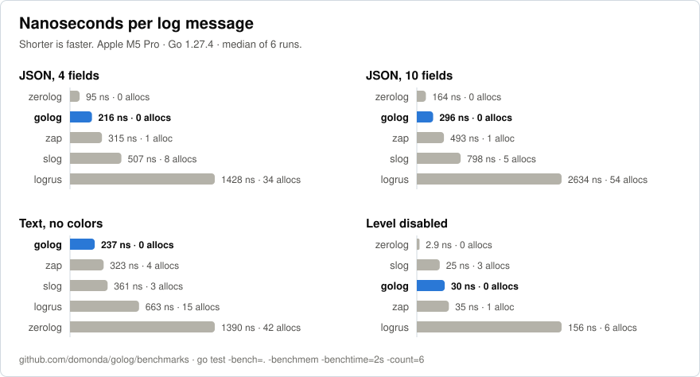
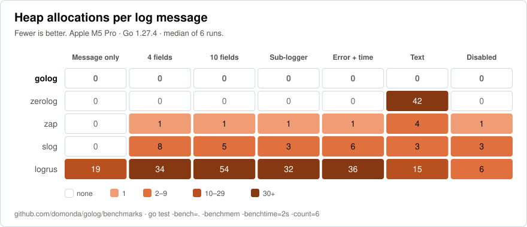

# Golog Comparative Benchmarks

Comparative benchmarks of golog and other Go structured logging libraries,
with the same scenarios on the same machine.

<picture>
  <source media="(prefers-color-scheme: dark)" srcset="charts/speed-dark.svg">
  
</picture>

<picture>
  <source media="(prefers-color-scheme: dark)" srcset="charts/allocs-dark.svg">
  
</picture>

## Libraries Compared

- **golog** - This library
- **zerolog** - High-performance structured logging
- **zap** - Uber's fast, structured, leveled logger
- **slog** - Go standard library's structured logging (Go 1.21+)
- **logrus** - Popular structured logger

## Running the Benchmarks

The benchmarks are in a separate module at `benchmarks/` to avoid adding dependencies on other
logging libraries (zerolog, zap, logrus) to the main golog module. The benchmarks module uses
a `replace` directive to reference the local golog package.

To run all comparative benchmarks from the golog directory:

```bash
go test ./benchmarks -bench=. -benchmem -benchtime=2s
```

Or from the benchmarks directory:

```bash
cd benchmarks
go test -bench=. -benchmem -benchtime=2s
```

To run a specific benchmark:

```bash
go test ./benchmarks -bench=BenchmarkSimpleMessage -benchmem
```

## Redrawing the Charts

`results.txt` holds the raw output of the run shown here. The charts in `charts/`
are drawn from it with the median of all runs:

```bash
cd benchmarks
go test -run '^$' -bench=. -benchmem -benchtime=2s -count=6 > results.txt
go run ./cmd/benchcharts results.txt charts
```

## Benchmark Scenarios

The benchmarks test several common logging scenarios:

### 1. BenchmarkSimpleMessage
Tests logging a simple message without any structured fields.
- **Use case**: Basic event logging
- **What it measures**: Baseline performance overhead

### 2. BenchmarkWithFields
Tests logging a message with 4 structured fields (string, int, float, bool).
- **Use case**: Standard structured logging
- **What it measures**: Field serialization performance

### 3. BenchmarkWithManyFields
Tests logging a message with 10 structured fields.
- **Use case**: Rich contextual logging
- **What it measures**: Performance with complex log entries

### 4. BenchmarkWithAccumulatedContext
Tests logging with pre-configured logger context.
- **Use case**: Request-scoped logging with common fields
- **What it measures**: Sub-logger and context handling efficiency

### 5. BenchmarkDisabled
Tests the overhead when logging at a disabled level.
- **Use case**: Debug logging in production
- **What it measures**: Branch prediction and no-op performance

### 6. BenchmarkComplexFields
Tests logging with complex types (errors, timestamps).
- **Use case**: Error logging and time-based events
- **What it measures**: Complex type serialization

### 7. BenchmarkTextOutput
Tests text/console output format instead of JSON.
- **Use case**: Human-readable development logs
- **What it measures**: Text formatting performance

## Benchmark Results

Results from an Apple M5 Pro with Go 1.27.4, median of 6 runs of
`go test -bench=. -benchmem -benchtime=2s -count=6` (18 CPUs):

```text
goos: darwin
goarch: arm64
cpu: Apple M5 Pro

BenchmarkSimpleMessage/golog-18         	 15091907	       151 ns/op	       0 B/op	       0 allocs/op
BenchmarkSimpleMessage/zerolog-18       	 73926669	        32 ns/op	       0 B/op	       0 allocs/op
BenchmarkSimpleMessage/zap-18           	 11950158	       180 ns/op	       0 B/op	       0 allocs/op
BenchmarkSimpleMessage/slog-18          	  9700477	       228 ns/op	       0 B/op	       0 allocs/op
BenchmarkSimpleMessage/logrus-18        	  3728339	       632 ns/op	     778 B/op	      19 allocs/op

BenchmarkWithFields/golog-18            	 10245143	       216 ns/op	       0 B/op	       0 allocs/op
BenchmarkWithFields/zerolog-18          	 21385627	        95 ns/op	       0 B/op	       0 allocs/op
BenchmarkWithFields/zap-18              	  7280741	       315 ns/op	     256 B/op	       1 allocs/op
BenchmarkWithFields/slog-18             	  4601128	       507 ns/op	     104 B/op	       8 allocs/op
BenchmarkWithFields/logrus-18           	  1671499	      1428 ns/op	    1653 B/op	      34 allocs/op

BenchmarkWithManyFields/golog-18        	  7540453	       296 ns/op	       0 B/op	       0 allocs/op
BenchmarkWithManyFields/zerolog-18      	 12920101	       164 ns/op	       0 B/op	       0 allocs/op
BenchmarkWithManyFields/zap-18          	  4768491	       493 ns/op	     705 B/op	       1 allocs/op
BenchmarkWithManyFields/slog-18         	  2958619	       798 ns/op	     240 B/op	       5 allocs/op
BenchmarkWithManyFields/logrus-18       	   906701	      2634 ns/op	    3403 B/op	      54 allocs/op

BenchmarkWithAccumulatedContext/golog-18	  8872511	       255 ns/op	       0 B/op	       0 allocs/op
BenchmarkWithAccumulatedContext/zerolog-18	 43425163	        54 ns/op	       0 B/op	       0 allocs/op
BenchmarkWithAccumulatedContext/zap-18  	  9319576	       250 ns/op	     128 B/op	       1 allocs/op
BenchmarkWithAccumulatedContext/slog-18 	  6791569	       338 ns/op	      48 B/op	       3 allocs/op
BenchmarkWithAccumulatedContext/logrus-18	  1750000	      1362 ns/op	    1612 B/op	      32 allocs/op

BenchmarkDisabled/golog-18              	 79390591	        30 ns/op	       0 B/op	       0 allocs/op
BenchmarkDisabled/zerolog-18            	804224467	       2.9 ns/op	       0 B/op	       0 allocs/op
BenchmarkDisabled/zap-18                	 68885992	        35 ns/op	     128 B/op	       1 allocs/op
BenchmarkDisabled/slog-18               	 96233388	        25 ns/op	      48 B/op	       3 allocs/op
BenchmarkDisabled/logrus-18             	 13297892	       156 ns/op	     528 B/op	       6 allocs/op

BenchmarkComplexFields/golog-18         	  9862886	       224 ns/op	       0 B/op	       0 allocs/op
BenchmarkComplexFields/zerolog-18       	 26880876	        89 ns/op	       0 B/op	       0 allocs/op
BenchmarkComplexFields/zap-18           	  6901563	       325 ns/op	     256 B/op	       1 allocs/op
BenchmarkComplexFields/slog-18          	  5031416	       456 ns/op	     104 B/op	       6 allocs/op
BenchmarkComplexFields/logrus-18        	  1694711	      1398 ns/op	    1734 B/op	      36 allocs/op

BenchmarkTextOutput/golog-18            	  9273329	       237 ns/op	       0 B/op	       0 allocs/op
BenchmarkTextOutput/zerolog-18          	  1721596	      1390 ns/op	    1631 B/op	      42 allocs/op
BenchmarkTextOutput/zap-18              	  6966953	       323 ns/op	     192 B/op	       4 allocs/op
BenchmarkTextOutput/slog-18             	  6373942	       361 ns/op	      48 B/op	       3 allocs/op
BenchmarkTextOutput/logrus-18           	  3524602	       663 ns/op	    1169 B/op	      15 allocs/op
```

### Golog Allocation Summary

| Scenario                       | ns/op   | B/op  | allocs/op |
|--------------------------------|---------|-------|-----------|
| Simple Message                 | 151     | 0     | 0         |
| With Fields (4 fields)         | 216     | 0     | 0         |
| Many Fields (10 fields)        | 296     | 0     | 0         |
| Accumulated Context            | 255     | 0     | 0         |
| Complex Fields (error, time)   | 224     | 0     | 0         |
| Text Output                    | 237     | 0     | 0         |
| **Disabled Logging**           | **30**  | **0** | **0**     |

### Library Allocation Comparison

| Library     | Simple Message      | With Fields          | Disabled           |
|-------------|---------------------|----------------------|--------------------|
| **zerolog** | 0 B/op, 0 allocs    | 0 B/op, 0 allocs     | 0 B/op, 0 allocs   |
| **golog**   | 0 B/op, 0 allocs    | 0 B/op, 0 allocs     | 0 B/op, 0 allocs   |
| **zap**     | 0 B/op, 0 allocs    | 256 B/op, 1 alloc    | 128 B/op, 1 alloc  |
| **slog**    | 0 B/op, 0 allocs    | 104 B/op, 8 allocs   | 48 B/op, 3 allocs  |
| **logrus**  | 778 B/op, 19 allocs | 1653 B/op, 34 allocs | 528 B/op, 6 allocs |

### What golog Does Beyond the Comparison

`BenchmarkGologFeatures` measures golog features the comparative scenarios don't use,
each with the 4 fields of `BenchmarkWithFields`:

| Sub-benchmark                              | What it adds                                         | ns/op | allocs/op |
|--------------------------------------------|------------------------------------------------------|-------|-----------|
| `one-writer`                               | the baseline, one JSON writer                        | 209   | 0         |
| `json-and-text-writers`                    | a text writer, written in the same call              | 430   | 0         |
| `context-attribs`                          | 2 attributes from the message's `context.Context`    | 260   | 0         |
| `recorded-and-context-attribs-two-writers` | a sub-logger attribute, the 2 context attributes and both writers | 631 | 0 |

## Performance Analysis

### JSON Output Speed Ranking (fastest to slowest)
1. **zerolog** - Fastest for JSON output across all scenarios (32-164 ns/op)
2. **golog** - Faster than zap in every scenario except accumulated context (151-296 ns/op)
3. **zap** - Strong performance (180-493 ns/op)
4. **slog** - Good performance from standard library (228-798 ns/op)
5. **logrus** - Slowest of the tested libraries (632-2634 ns/op)

### Text/Console Output Speed Ranking (fastest to slowest)
1. **golog** - Fastest for text output (237 ns/op, 0 allocs)
2. **zap** - Strong text formatting performance (323 ns/op)
3. **slog** - Good text formatting (361 ns/op)
4. **logrus** - Moderate performance (663 ns/op)
5. **zerolog** - ConsoleWriter is significantly slower (1390 ns/op, 42 allocs)

### Memory Allocation Ranking (lowest to highest)
1. **golog** and **zerolog** - Zero allocations in every JSON scenario; golog also for text
2. **zap** - Minimal allocations (0-4 per log)
3. **slog** - Variable allocations (0-8 per log depending on scenario)
4. **logrus** - Highest allocations (528-3403 B/op)

### Key Observations

**zerolog's Zero-Allocation Design**
- Uses a fluent API with sync.Pool for zero allocations in JSON mode
- Optimized for high-throughput JSON logging scenarios
- Fastest for JSON output (32-164 ns/op)
- **Important**: ConsoleWriter for text output is significantly slower (1390 ns/op) with 42 allocations per log entry—this is a known limitation of zerolog's text formatting

**zap's Performance**
- Excellent balance of speed and features
- More allocations than zerolog but still minimal
- Strong performance with complex fields (180-493 ns/op)
- Slightly faster than golog with accumulated context (250 vs 255 ns/op)
- Good text/console output performance (323 ns/op)

**golog's Zero-Allocation Design**
- Zero allocations in all seven scenarios: JSON, text, complex fields and a sub-logger with attributes
- Faster than slog for JSON: 151 vs 228 ns/op (simple), 216 vs 507 ns/op (with fields)
- Faster than zap: 151 vs 180 ns/op (simple), 216 vs 315 ns/op (4 fields), 296 vs 493 ns/op (10 fields)
- Complex fields (error, time): 224 ns/op with 0 allocs vs zap's 325 ns/op with 1 alloc
- Disabled logging at 30 ns/op with 0 allocs; slog is faster (25 ns/op) but allocates 3 times
- **Fastest text output** (237 ns/op, 0 allocs) faster than zap (323 ns/op) and slog (361 ns/op)
- Writes one message to several writers and adds context attributes without allocating

**slog's Standard Library Benefits**
- No external dependencies
- Good performance for a standard library solution
- Built-in support in Go 1.21+
- Solid text output performance (361 ns/op)

**logrus Performance**
- Mature library with wide adoption
- Slower and more allocations than modern alternatives
- Consider migrating to newer libraries for performance-critical applications

## When to Choose Each Library

**Choose golog when:**
- You need flexible configuration options
- Multiple output formats and writers are required
- Zero allocations when disabled is important
- Integration with existing domonda ecosystem

**Choose zerolog when:**
- Raw performance is critical
- High-throughput logging is needed
- Minimizing allocations is important

**Choose zap when:**
- You need excellent performance with rich features
- Production logging at scale
- Strong typing is important

**Choose slog when:**
- You prefer standard library solutions
- Go 1.21+ is available
- Good-enough performance with no dependencies


**Choose logrus when:**
- You have existing code using it
- Performance is not a primary concern
- Wide plugin ecosystem is needed

## References

- [Better Stack Go Logging Benchmarks](https://betterstack.com/community/guides/logging/best-golang-logging-libraries/)
- [Better Stack Go Logging Benchmarks Repository](https://github.com/betterstack-community/go-logging-benchmarks)
- [Zerolog Repository](https://github.com/rs/zerolog)
- [Zap Repository](https://github.com/uber-go/zap)
- [Slog Documentation](https://pkg.go.dev/log/slog)
- [Logrus Repository](https://github.com/sirupsen/logrus)
